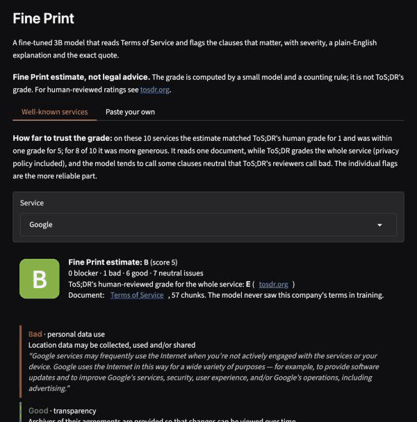
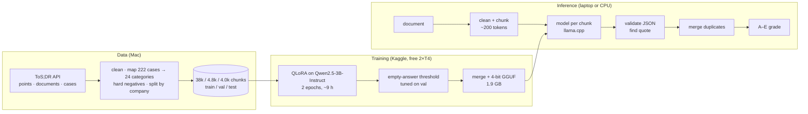

# Fine Print 🔍

**A fine-tuned 3B-parameter LLM that reads Terms of Service and flags the clauses that matter — in plain English,
with a severity and the exact quote.** Runs on a laptop; built entirely on free resources.

**[Demo](https://huggingface.co/spaces/rupp15/fine-print)** (10 well-known services, analysed) ·
**[Model](https://huggingface.co/rupp15/fine-print-gguf)** (4-bit GGUF, 1.9 GB) ·
**[Labels](https://huggingface.co/datasets/rupp15/fine-print-tos-labels)** (31k human-reviewed clauses) · Built with Qwen

> ⚠️ Not legal advice. Grades are "Fine Print estimates", not ToS;DR's human-reviewed ratings.



## The problem

Nobody reads Terms of Service: the average document is thousands of words of legal text. [ToS;DR](https://tosdr.org)
volunteers read them by hand and record what matters ("you waive your right to a class action", "you keep
ownership of your content"), but they can only cover so many services, and terms change. Fine Print learns from
ToS;DR's human-reviewed points to do a first pass automatically, on any text, and shows its evidence: every flag
comes with the exact quote it is based on.

One flag the model returned for a chunk of Uber's U.S. Terms of Use (a company it never saw in training):

```json
{"flags": [{"category": "dispute_resolution", "severity": "bad",
            "explanation": "You waive your right to a class action",
            "quote": "You acknowledge and agree that you and Uber are each waiving the right to a trial by jury or to participate as a plaintiff or class member in any purported class action or representative proceeding."}]}
```

## How it works



- **Data.** 301k ToS;DR points → 31.5k human-approved clauses with quotes, mapped onto 24 categories with a
  severity. Training chunks are windows of real documents around each quote, plus "hard negative" chunks (same
  documents, nothing flagged). Train, validation and test are **split by company**, so the test set measures
  unseen companies, not memorised boilerplate. LexGLUE `unfair_tos` (CLAUDETTE) is an external test set only.
- **Model.** Qwen2.5-3B-Instruct, QLoRA (4-bit base + LoRA rank 16), loss on the answer only. Trained on Kaggle's
  free GPUs, driven from a Mac with the Kaggle CLI.
- **The threshold.** The answer always starts `{"flags":`; the next token decides "nothing to flag" vs "flag". The
  model's probability for "nothing" is compared with a threshold tuned on validation (0.9), which lifted recall
  from 0.68 to 0.87 without retraining.
- **Serving.** The adapter is merged and quantized to a 1.9 GB GGUF and run with llama.cpp. The threshold runs
  there too, by reading the logits directly. A document is cleaned, chunked, analysed chunk by chunk, every quote
  is checked against the text, duplicates across overlapping chunks are merged, and a transparent counting rule
  turns the flags into an A–E grade.

## Results

Held-out companies (test set, 4,024 chunks):

| System | Precision | Recall | Category macro-F1 | Severity acc | Flags harmless chunks |
|---|---|---|---|---|---|
| Always flag (reference) | 0.647 | 1.000 | 0.006 | 0.584 | 100% |
| Keyword rules | 0.693 | 0.919 | 0.371 | 0.664 | 74% |
| TF-IDF + logistic regression | 0.862 | 0.815 | 0.617 | 0.675 | 21% |
| DeBERTa-v3-small classifier | 0.846 | 0.881 | 0.635 | 0.678 | 27% |
| Fine-tune, 1 epoch, greedy | **0.933** | 0.681 | 0.571 | 0.851 | **7%** |
| + empty-answer threshold | 0.869 | 0.871 | 0.626 | 0.842 | 21% |
| **+ 2nd epoch (the model)** | 0.870 | **0.909** | **0.662** | **0.854** | 22% |

- **Base Qwen 3B vs fine-tuned** (500-chunk subset): category macro-F1 0.22 zero-shot / 0.33 few-shot → 0.66;
  severity 0.29 → 0.85. Fine-tuning is what makes a 3B model usable here.
- **vs the specialist classifier:** the fine-tune beats DeBERTa on macro-F1 (0.662 vs 0.635), ties or beats it on
  18 of 24 categories, and is far better at severity (0.85 vs 0.68); and it explains itself and quotes its source.
- **Faithful quotes:** 99.2% of quotes appear verbatim in the input; 100% valid JSON.
- **4-bit model:** test-500 macro-F1 0.652 vs 0.658 at full precision; ~1.5 s per chunk with nothing to flag and
  ~5 s per flagged chunk on an M1 Mac with 8 GB.

All numbers: [results/RESULTS.md](results/RESULTS.md) · findings per milestone:
[baselines](results/baselines_v0.3.md) · [first fine-tune](results/finetune_v0.4.md) ·
[error analysis](results/error_analysis_v1.md) · [threshold + 2nd epoch](results/finetune_v0.5.md) ·
[whole-service grades](results/service_grades.md)

### Error analysis, in short
- Most misses of the first model were **silence**: 56% of missed labels were chunks it answered with no flags at
  all. That is what the threshold fixed.
- The hardest categories (transparency, advertising, third-party sharing) are hard for every system; 35% of
  `transparency` labels are section headings rather than clauses, i.e. label noise.
- Confusions are between neighbouring categories (third-party sharing ↔ tracking ↔ personal data use;
  liability ↔ warranty), not random.

## Limitations

- **The grade is the weakest part.** <!-- service-grades-summary -->
- **LexGLUE:** on an older, lowercased, differently-labelled contract set the final model scores 0.466 macro-F1,
  below DeBERTa (0.559) and the 1-epoch model (0.589): the second epoch fitted ToS;DR's labelling style more closely.
- **Labels are ToS;DR's.** The model learns what ToS;DR's volunteers chose to record; points they never wrote
  down look like false alarms, and their 24-category mapping is ours (D24).
- **English only**, and quotes must be in the chunk the model sees (~200 tokens), so clauses that only make sense
  across sections are missed.
- **Not legal advice**; it reads text, not how a company actually behaves.

## Try it

- **Browse** the [demo](https://huggingface.co/spaces/rupp15/fine-print): 10 services (8 the model never saw in
  training), with both grades and every flag.
- **Run it locally** on your own text (Python 3.12, [uv](https://docs.astral.sh/uv/)):

```bash
uv sync --extra app
```

```bash
uv run python -m fineprint.inference.pipeline --model fine-print-v2-q4_k_m.gguf --file terms.txt
```

```bash
uv run --extra app python app/app.py
```

The model file comes from [rupp15/fine-print-gguf](https://huggingface.co/rupp15/fine-print-gguf); `app/app.py`
downloads it automatically.

## Repo layout

```
configs/            data, taxonomy, training, grade rule, demo examples
src/fineprint/
  data/             fetch → stats → clean → taxonomy → build_dataset
  baselines/        always-flag, keywords, TF-IDF, DeBERTa
  training/         QLoRA training (run on Kaggle)
  eval/             eval sets, one scorer, threshold, error analysis, grade fit, whole-service grades
  inference/        GGUF runner, document pipeline, grade, demo examples
  chunk.py prompt.py   shared by data, training and inference
notebooks/          Kaggle notebooks and scripts (training, eval, GGUF export, demo examples)
app/                Gradio app (local), static demo page, model card
results/            metrics JSON + findings (committed)
docs/               architecture, decisions, concepts, data, roadmap
tests/
```

## Documentation

Every design choice has a numbered entry with alternatives and a one-line explanation
([DECISIONS.md](docs/DECISIONS.md), 44 entries); ML terms are explained in plain language in
[CONCEPTS.md](docs/CONCEPTS.md). Start at [docs/README.md](docs/README.md). Changes per version:
[CHANGELOG.md](CHANGELOG.md).

## Built on free resources

Kaggle's free GPUs (2×T4, ~30 h/week) for training and evaluation, Kaggle CPU sessions for conversion and long
CPU runs, Hugging Face for the model and the static demo, an M1 Mac with 8 GB for everything else. No paid
APIs, and no AI-generated labels: every training label is a human-reviewed ToS;DR point.

## Acknowledgements and licences

- Labels: the [ToS;DR](https://tosdr.org) volunteer community, CC BY-SA 3.0.
- External test set: LexGLUE (Chalkidis et al., 2022) / CLAUDETTE (Lippi et al., 2019).
- Base model: [Qwen2.5-3B-Instruct](https://huggingface.co/Qwen/Qwen2.5-3B-Instruct), Qwen Research License
  (non-commercial). **Built with Qwen.**
- Quoted clauses belong to the companies that wrote them; the demo shows short excerpts and links to the source.
