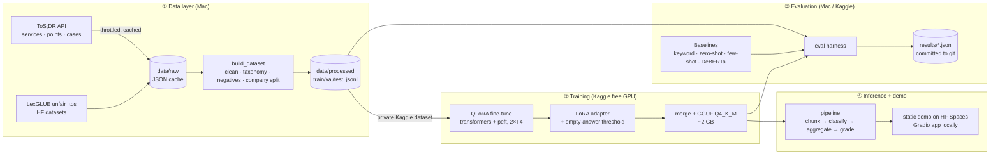
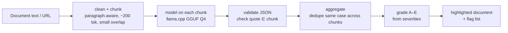

# Architecture — Fine Print

Fine Print reads a Terms of Service or privacy policy and flags risky clauses in plain English,
with a severity rating and the exact quote it is based on. It is a **fine-tuned ~3B-parameter LLM**
that runs locally (laptop CPU/GPU) — no paid API at inference time.

> Constraint for the whole project: **every resource is free** (Claude Code Pro is the only paid
> tool, used for writing code — never for generating training data).

---

## 1. System overview



Four layers, each with its own folder under `src/fineprint/` and clear file-based handoffs
between them (JSONL datasets, model files, results JSON). Any layer can be re-run alone.

---

## 2. The core task (what the model learns)

**Input:** one chunk of a legal document (~100–300 tokens).
**Output:** strict JSON — zero or more flags.

```json
{"flags": [
  {"category": "third_party_sharing",
   "severity": "bad",
   "explanation": "This service shares your personal data with third parties that are not essential to its operation",
   "quote": "share your personal information with third-party advertising partners"}
]}
```

`category` is one of 24 (D24), `severity` comes from the specific ToS;DR case, and `explanation` is
that case's curator-written title. The prompt and schema live in `src/fineprint/prompt.py` (D27).

Harmless chunk → `{"flags": []}`. Most real chunks are harmless, so learning to say *nothing*
is as important as learning to flag.

**Why per-chunk and not whole-document?** A full ToS is 5k–30k tokens. A 3B model degrades
badly on long context and it would not fit training memory on a T4. Chunking keeps every
example short, trainable, and lets us point at exact spans in the UI.

**Severity scale** (inherited from ToS;DR point ratings):

| Label | Meaning | UI colour |
|---|---|---|
| `good` | Protects the user | green |
| `neutral` | Worth knowing | grey |
| `bad` | Against the user's interest | orange |
| `blocker` | Serious — a reason to avoid the service | red |

---

## 3. Data layer — `src/fineprint/data/`

### Sources

| Source | What it gives | Role | Access |
|---|---|---|---|
| **ToS;DR** (`api.tosdr.org`) | *Points*: quoted clause + *case* (e.g. "This service can sell your data") + rating + service | Main training data; case titles are already plain-English explanations | Public REST API, **rate-limited** |
| **LexGLUE `unfair_tos`** (CLAUDETTE) | ~9.4k sentences from 50 ToS, 8 unfair-clause labels | External test set only (D28) | `datasets.load_dataset("coastalcph/lex_glue", "unfair_tos")` |

Verified 2026-11-04: LexGLUE loads (5,532 / 2,275 / 1,607 train/val/test). The ToS;DR API returned
HTTP 429 on the first request, so the fetcher **must** be polite.

### Pipeline stages

| Stage | Module | Output | Notes |
|---|---|---|---|
| Fetch | `fetch_tosdr.py points / documents / services` | `data/raw/tosdr/` | Disk cache = resumable; 2 s/request; exponential backoff on 429 (D08) |
| Fetch | `fetch_lexglue.py` | `data/raw/lexglue/` | Evaluation only, never training (D28) |
| Inspect | `stats.py` | `data/interim/points.parquet`, `results/data_stats.json` | One row per point, all statuses |
| Clean | `clean.py` | `data/interim/points_clean.parquet` | Approved only, HTML stripped, English, 20–1,500 chars, deduped (D07, D30) |
| Taxonomy | `taxonomy.py` + `configs/taxonomy.yaml` | `data/interim/points_labeled.parquet` | 222 cases → 24 categories; explanation = case title (D24) |
| Build | `build_dataset.py` (uses `chunk.py`, `prompt.py`) | `data/processed/{train,val,test}.jsonl` | Document windows around quotes, hard + easy negatives filtered by TF-IDF similarity to known quotes, service hash split, chat messages (D25, D26, D29, D31) |

### Processed example (one JSONL line)

```json
{"id": "train-000123", "kind": "positive | hard_negative | negative | bare",
 "group": "service:182", "doc_id": 452,
 "messages": [
   {"role": "system", "content": "<task instructions>"},
   {"role": "user", "content": "<chunk text>"},
   {"role": "assistant", "content": "{\"flags\": [...]}"}
 ]}
```

### Data versioning
Raw and processed data are **not** committed to git (too large, third-party content). Instead:
- `configs/data.yaml` records the dataset version string,
- processed splits are pushed to a **private Hugging Face dataset repo** (free) tagged with that version,
- `results/` files record which dataset version they were computed on.

---

## 4. Training — `src/fineprint/training/` + `notebooks/`

| Choice | Value | Why |
|---|---|---|
| Base model | `Qwen2.5-3B-Instruct` (alt: `Llama-3.2-3B-Instruct`) | Strong at JSON at 3B size; swappable via `configs/train.yaml` |
| Method | **QLoRA** — 4-bit frozen base + LoRA adapters (r=16, α=32, all linear layers) | Fits a free 16 GB T4 |
| Library | Unsloth + TRL `SFTTrainer` | ~2× faster, less memory on free GPUs |
| Loss | **Completion-only** (mask system+user tokens) | Model learns to answer, not to echo legal text |
| Hyper-params (start) | lr 2e-4, 2 epochs, max_len 1024, eff. batch 16, cosine schedule | Sensible QLoRA defaults; tuned in v0.4 |
| Compute | Kaggle 2×T4 (≈30 GPU-h/week), Colab T4 as backup | Free |
| Checkpoints | Pushed to private HF model repo every N steps | Kaggle sessions die at ~12 h |

The training notebook pulls code from this GitHub repo and data from the HF dataset repo, so the
notebook itself stays thin and the logic is versioned here.

**Why not train on the Mac?** M1 / 8 GB unified memory cannot hold a 3B model + optimizer state +
activations comfortably. The Mac is used for everything else.

---

## 5. Evaluation — `src/fineprint/eval/`, `src/fineprint/baselines/`

Every system — baseline or fine-tuned — writes predictions in the **same JSON format**, and one
harness scores them all into `results/eval/<system>__<set>.json`; `results/RESULTS.md` is generated from
those (D32). Eval sets: `test`, `test-500` (for slow systems), `lexglue`.

**Where things run (D35):** cheap systems and all scoring on the Mac; LLM baselines, DeBERTa and later
fine-tuning on Kaggle's two T4 GPUs via `notebooks/kaggle_baselines.ipynb`, with code + data shipped as one
zip (`fineprint.kaggle_bundle`) and results re-imported with `fineprint.kaggle_results`.

### Systems compared

| # | System | Question it answers |
|---|---|---|
| ref | Always flag (most common category) | What do the metrics give for free? (D32) |
| B0 | Keyword / regex rules | Is this task trivially solvable? |
| B0b | TF-IDF + logistic regression | What does the best *cheap* classifier get? (D33) |
| B1 | Base 3B, zero-shot | What does the model know before training? |
| B2 | Base 3B, few-shot | How far does prompting alone get? |
| B3 | DeBERTa-v3-small multi-label classifier | Is a generative LLM even needed for *detection*? |
| FT | Fine-tuned 3B (QLoRA): `ft_qwen3b_v2` (2 epochs) + empty-answer threshold t = 0.9 → `ft_qwen3b_v2_tuned` | Our model: `training/train.py` on Kaggle 2×T4 (D37, D39), threshold D38, adapters in `data/models/`; `v1` (1 epoch) kept for comparison |
| (ref) | ToS;DR DocBot (123 per-case binary classifiers) | Related work — discussed, not re-run |

### Metrics

| Metric | Level | Detects |
|---|---|---|
| Detection P / R / F1 | chunk | crying wolf vs missing risks |
| Category macro-F1 | flag | getting the *type* right, rare types included |
| Severity accuracy (+ confusion matrix) | flag | bad vs blocker mix-ups |
| JSON validity rate | output | can the app trust the output? |
| Quote faithfulness | flag | % of quotes that literally appear in the input (hallucination check) |
| LexGLUE F1 (mapped 8 labels) | external | generalisation beyond ToS;DR |
| Latency (s / chunk, Mac + CPU Space) | system | is the demo usable? |

Plus a manual **error analysis** of ≥50 mistakes per major version, saved in `results/`.

---

## 6. Inference & demo — `src/fineprint/inference/`, `app/`



- **Runtime:** `llama-cpp-python` with the merged GGUF Q4_K_M file (1.93 GB, D40), `inference/gguf.py`. The
  empty-answer threshold (D38) runs inside it by reading logits. Same file on the Mac and on HF Spaces; outputs
  can differ slightly between machines (floating point), 76/82 identical in a check.
- **Pipeline:** `inference/pipeline.py` `analyse_document`: clean → chunk (same chunker as the dataset) →
  `GGUFModel.analyse` per chunk → parse/validate → locate each quote in the document → merge same-category flags
  with overlapping spans → grade.
- **Demo (D42):** public Static Space `rupp15/fine-print` showing 10 precomputed services (`app/static/`,
  `app/examples.json`, built by `inference/examples.py` on Kaggle CPU). The Gradio app (`app/app.py`, paste your
  own text) runs locally; a live ZeroGPU version follows when the HF account qualifies.
- **Speed:** M1 ~1.5 s per chunk answered empty, ~5.4 s per flagged chunk; a median document (~28 chunks) takes
  ~45 s–2.5 min. On the free 2-vCPU Space: precomputed results for ~10 well-known services, a cap on pasted
  length; a DeBERTa pre-filter stays optional.
- **Grade:** score = good − bad − 2·blocker over distinct (category, severity) pairs, cut-points A ≥ 7, B ≥ 2,
  C ≥ 0, D ≥ −6, fitted on ToS;DR's human grades (D41, `configs/grade.yaml`); shown as a "Fine Print estimate".
- Disclaimer on every page: *not legal advice*.

---

## 7. Key design decisions

Summary only. Full reasoning and alternatives for every decision are in [DECISIONS.md](DECISIONS.md).

| Decision | Alternative rejected | Reason |
|---|---|---|
| Split by **service** | Random split | Companies reuse boilerplate; random split leaks near-duplicates into test and inflates scores |
| One generative model with explanations | 123 binary classifiers (DocBot style) | One small artefact; produces explanation + quote; tests whether a 3B LLM can match specialist classifiers |
| Labels from human ToS;DR data | Synthetic data from a big LLM | Free, real, and avoids Claude terms (no training on Claude outputs) |
| ~20–25 merged categories | All ToS;DR cases | Long tail has too few examples to learn |
| GGUF + llama.cpp | Transformers on CPU | 4× smaller, much faster on CPU and Apple Silicon; −0.006 macro-F1 (D40) |
| Fitted A–E counting rule | Hand-written rule | Checked against ToS;DR's human grades: never more than one grade off on held-out services (D41) |
| Results JSON in git | Paid experiment tracker | Free, versioned with the code that produced it |

---

## 8. Free resource map

| Need | Resource | Limit to watch |
|---|---|---|
| Code + versions | GitHub (private repo) | — |
| Local dev | MacBook Air M1, 8 GB | Run ≤3B Q4 models only; no training |
| Python env | `uv` + Python 3.12 | — |
| GPU training | Kaggle notebooks (2×T4) | ~30 h/week, 12 h/session |
| Backup GPU | Google Colab free T4 | Session limits vary |
| Data + model storage | Hugging Face Hub (private repos) | — |
| Demo hosting | HF Spaces, CPU basic | 2 vCPU / 16 GB, sleeps when idle |
| Coding assistant | Claude Code (Pro) | Not used to generate training data |

---

## 9. Risks

| Risk | Mitigation |
|---|---|
| ToS;DR API throttling / changes | Slow cached fetcher; LexGLUE fallback; ask team@tosdr.org for a dump (they plan to publish datasets) |
| ToS;DR data licence / attribution | Verify in v0.1; attribute in README + model card; don't redistribute raw text publicly |
| Noisy / inconsistent labels | Merge categories, report as limitation, inspect in error analysis |
| Kaggle session timeouts | Checkpoint to HF Hub |
| FT does not beat DeBERTa on detection | Still a valid finding; LLM's edge is explanation + quote — report honestly |
| Slow demo on free CPU | Precomputed examples, length cap, pre-filter |
